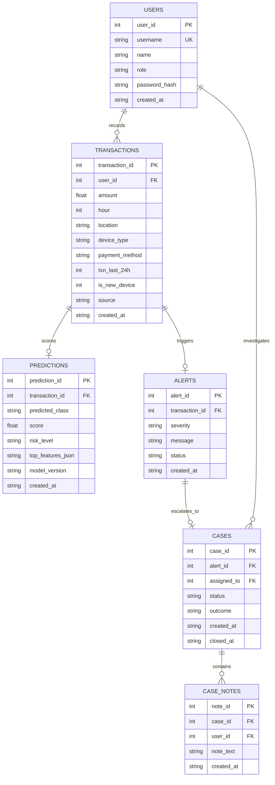

# FraudGuard AI — Master Implementation & Architecture Plan

> **Project Identity:** FraudGuard AI — Transaction Fraud Detection & Threat Intelligence Platform  
> **Release Target:** v2.4 Production Engine • Enterprise FinTech SecOps Platform  
> **Status:** Active Production Architecture  
> **Target Standard:** Enterprise FinTech Cyber-Defense Workstation (Stripe Radar / Palantir Foundry tier)

---

## 1. Executive Summary & Transformation Goals

The existing prototype provides a functional proof-of-concept using a scikit-learn `RandomForestClassifier` and basic Flask routes, but suffers from:
- A rudimentary 58-line CSS stylesheet with dated 2000s styling.
- Static Matplotlib PNG charts written to disk on every single page view.
- Severe lack of interactive UX (full-page reloads, no search/filters, no XAI factor breakdown).
- No case management, live simulation controls, model introspection, or real-time triage.

**FraudGuard AI** transforms this project into a comprehensive, interactive fraud operations platform preserving the existing stack (Python, Flask, SQLite, Scikit-Learn, HTML/CSS/JS) while upgrading UI/UX, database architecture, and REST capabilities.

---

## 2. Technology Stack & Architecture Constraints

```
┌────────────────────────────────────────────────────────────────────────┐
│                         FRAUDGUARD AI SYSTEM                           │
├────────────────────────────┬───────────────────────────────────────────┤
│ Frontend Presentation      │ HTML5, Modern Vanilla CSS (Design Tokens),│
│                            │ Vanilla JS (ES6+), Canvas / Chart.js      │
├────────────────────────────┼───────────────────────────────────────────┤
│ Application Backend        │ Python 3.13, Flask (App Factory & Routes) │
├────────────────────────────┼───────────────────────────────────────────┤
│ Machine Learning Layer     │ scikit-learn (Random Forest Pipeline),    │
│                            │ pandas, numpy, joblib                     │
├────────────────────────────┼───────────────────────────────────────────┤
│ Relational Storage         │ SQLite (scam_detection.db) with enhanced  │
│                            │ schemas (Transactions, Alerts, Cases)     │
├────────────────────────────┼───────────────────────────────────────────┤
│ Design Protocol            │ Google Stitch AI UI Prompts -> Frontend   │
└────────────────────────────┴───────────────────────────────────────────┘
```

---

## 3. FinTech Design System Specification

| Token / Category | Value / Description | Usage |
| :--- | :--- | :--- |
| **Theme Rule** | **Strictly Light Theme Only** | Standardized across all 12 modules |
| **Canvas Background** | `#F8FAFC` (Clean Slate 50) | Main page background |
| **Card / Surface** | `#FFFFFF` (Crisp Pure White) | KPI cards, data tables, modals |
| **Card Border** | `#E2E8F0` (Subtle Slate 200) | Structural clean borders |
| **Text Primary** | `#0F172A` (Deep Slate Navy 900) | Headings, key data points |
| **Text Muted** | `#64748B` (Muted Slate 500) | Helper text, secondary labels |
| **Brand Primary** | `#2563EB` (Electric Royal Blue), Hover: `#1D4ED8` | Primary CTAs, active links, accents |
| **Brand Secondary** | `#0EA5E9` (Sky Blue / Cyber Accent) | Focus rings, highlight tags |
| **Risk: Legitimate / Safe**| `#10B981` (Emerald Green, Soft Bg: `#ECFDF5`) | Safe badges, low risk (0-30%) |
| **Risk: Suspicious / Medium**| `#F59E0B` (Warm Amber, Soft Bg: `#FFFBEB`) | Review alerts, medium risk (31-70%) |
| **Risk: Critical / Fraud**| `#EF4444` (Vibrant Crimson Red, Soft Bg: `#FEF2F2`) | Fraud flags, critical alerts (>70%) |
| **Typography** | `Inter`, `Plus Jakarta Sans`, system fallback | Clean modern financial UI |

---

## 4. Database Schema Upgrades

The existing SQLite schema will be upgraded to support audit logging, analyst cases, and configurable thresholds:



---

## 5. Phased Implementation Roadmap

### 📋 Phase 1: Foundation, Data Layer & Authentication
- [ ] **Step 1.1**: Upgrade database schema (`init_db` in `app.py`) to support alerts, cases, notes, system settings, and custom thresholds.
- [ ] **Step 1.2**: Provide the Google Stitch prompt for **Page 1: Login & Access Portal**.
- [ ] **Step 1.3**: Build backend auth routes (`/login`, `/logout`, `/api/auth/demo-switch`) and the responsive, glassmorphic Login page based on the generated design.

---

### 📋 Phase 2: Core ML Detection & Intelligence Engine
- [ ] **Step 2.1**: Refactor model scoring helper to support Explainable AI (XAI) feature contribution weights and dynamic risk thresholds.
- [ ] **Step 2.2**: Provide the Google Stitch prompt for **Page 4: Fraud Detection (Single Txn Analyzer)**.
- [ ] **Step 2.3**: Implement `/analyze` with interactive quick-fill scenario presets, animated SVG risk speedometer, and feature contribution breakdown cards.
- [ ] **Step 2.4**: Provide the Google Stitch prompt for **Page 9: Batch Transaction Analysis**.
- [ ] **Step 2.5**: Implement `/upload` with drag-and-drop CSV dropzone, client-side preview, validation summary, and bulk CSV export.

---

### 📋 Phase 3: Executive Command Center & Live Simulation
- [ ] **Step 3.1**: Create REST endpoints for dashboard metrics and client-side Chart.js feeds (retiring static Matplotlib PNG generation).
- [ ] **Step 3.2**: Provide the Google Stitch prompt for **Page 2: Executive Dashboard / Overview**.
- [ ] **Step 3.3**: Implement the Command Center with animated KPI stat cards, interactive charts, and high-risk alert stream.
- [ ] **Step 3.4**: Provide the Google Stitch prompt for **Page 10: Simulated Real-Time Monitoring**.
- [ ] **Step 3.5**: Implement `/simulate` with real-time simulated transaction engine (Start, Pause, Resume, Speed Slider, and Live Audio/Visual Threat Ticker).

---

### 📋 Phase 4: Operations, Alerts & Case Investigation
- [ ] **Step 4.1**: Provide the Google Stitch prompt for **Page 3: Transaction Monitoring**.
- [ ] **Step 4.2**: Implement `/transactions` with live search, column sorting, date/amount filters, pagination, and slide-over detail drawer.
- [ ] **Step 4.3**: Provide the Google Stitch prompt for **Page 5: Fraud Alerts Queue**.
- [ ] **Step 4.4**: Implement `/alerts` with severity filter (Low, Medium, High, Critical), bulk triage, and one-click "Escalate to Case".
- [ ] **Step 4.5**: Provide the Google Stitch prompt for **Page 6: Fraud Investigation and Case Management**.
- [ ] **Step 4.6**: Implement `/cases` with status kanban/timeline (New, Under Investigation, Confirmed Fraud, False Positive, Closed), analyst assignment, and case notes audit log.

---

### 📋 Phase 5: Analytics, Model Governance & Settings
- [ ] **Step 5.1**: Provide the Google Stitch prompt for **Page 7: Analytics and Reports**.
- [ ] **Step 5.2**: Implement `/analytics` with multi-dimensional trends, fraud-by-category charts, date range selector, and CSV/PDF report download.
- [ ] **Step 5.3**: Provide the Google Stitch prompt for **Page 8: Model Insights & Performance**.
- [ ] **Step 5.4**: Implement `/model-insights` with real confusion matrix, ROC-AUC curve, feature importance ranking, and threshold sensitivity slider.
- [ ] **Step 5.5**: Provide the Google Stitch prompt for **Page 11: Settings and User Profile**.
- [ ] **Step 5.6**: Implement `/settings` with notification preferences, analyst profile, security credentials, and threshold configuration (Light Theme interface).

---

## 6. The Google Stitch UI Workflow Protocol

For every single page before writing HTML/CSS:
1. **Prompt Generation**: We provide a comprehensive, ultra-detailed prompt specifying typography, layout, color tokens, widgets, states, and FinTech design aesthetics.
2. **Design Generation**: You run the prompt in Google Stitch to generate the visual layout.
3. **Frontend Implementation**: We inspect the resulting design and write the pixel-perfect, clean, accessible HTML/CSS/JS frontend connected to our Flask backend and SQLite database.

---

## 7. Current Action Item

- **Active Page:** Page 1 — Login Page
- **Stitch Prompt Status:** Delivered & Ready to Run in Google Stitch.
- **Awaiting:** User confirmation / design output to implement Phase 1.
